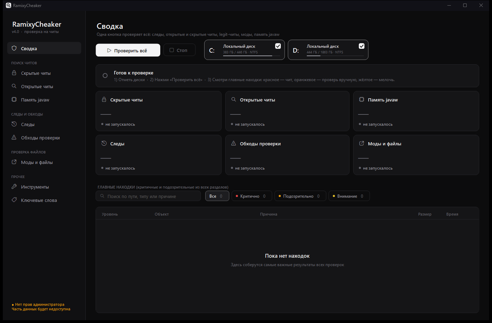

<div align="center">

# RamixyCheaker

**Проверка ПК на читы для Minecraft одной кнопкой**


[**Скачать RamixyCheaker.exe**](https://github.com/Ramixy/RamixyCheaker/releases/latest)



</div>

## Скриншоты

**Поиск файлов**: мгновенный поиск по всем дискам, у каждого файла видно, откуда он взялся.


**Декомпилятор**: дерево классов JAR, Java-код через CFR, подсветка подозрительных классов.


## Что это

Инструмент для скриншара: находит инжектируемые клиенты (Doomsday, Cortex, System, DLC, Vape и др.), читы, замаскированные под системные файлы, открытые читы по названиям и размерам, а также проверяет моды. Один exe, без установки. Для Java-кода в декомпиляторе нужна любая Java на ПК (у игроков Minecraft она есть), без неё показывается байткод.

> Принцип против ложных срабатываний: **если файл подтверждён системой (валидная цифровая подпись), он не трогается.**

## Разделы

| Раздел | Что делает |
|---|---|
| **Сводка** | Кнопка «Проверить всё»: запускает все проверки подряд по выбранным дискам и собирает главные находки. |
| **Скрытые читы** | Файлы, замаскированные под другое (EXE/JAR под видом `.dll`, `.ini`, `.png`), подделки системных библиотек, нативный JNI-инжект. Сюда же входят legit-читы (кликеры, макросы, ghost-клиенты, агенты javaw) и файлы, скачанные с сайтов читов. |
| **Открытые читы** | Быстрый поиск по названиям, точным размерам и шаблонам из списка размеров: все диски, процессы, установленные программы, автозапуск. |
| **Память javaw** | Карточка процесса Minecraft (версия, загрузчик, аргументы запуска), список **всех загруженных модулей** с подписью, скрытые и удалённые DLL, manual-map, строки читов в памяти. |
| **Следы** | Prefetch, BAM, UserAssist, MuiCache, AppCompat, недавние файлы, загрузки, папки лаунчеров, **история браузеров и DNS-кэш**: сайты читов видны, даже если файл удалён. |
| **Обходы проверки** | Пытались ли сломать проверку: hosts, заблокированные сайты, DisallowRun, IFEO, taskkill в автозапуске, очистка журналов, выключенный Prefetch, удалённый USN-журнал, перевод времени, WinRAR-стеганография и др. Только поиск, ничего не меняет. |
| **Моды и файлы** | Перетащи мод, папку или любой файл: проверка на чит. Либо автоматически найдёт папки модов всех лаунчеров. |
| **Поиск файлов** | Мгновенный поиск любого файла по имени, как в Everything (с правами администратора индекс строится из MFT за секунды). Маски `*.jar`, `ext:exe,dll`, `\Downloads\`, `!исключить`. Для каждого файла видно, откуда он взялся. |
| **Декомпилятор** | Разбор JAR: дерево классов, классы с признаками чита подсвечены красным, Java-код через встроенный CFR (нужна любая Java на ПК) или байткод без Java. Для EXE/DLL: подпись, «системный или сторонний», секции, импорт, экспорт, строки. |
| **Инструменты** | Встроенные SS-утилиты, NirSoft (в т.ч. BrowsingHistoryView, AlternateStreamView, UserAssistView, LoadedDllsView) и Sysinternals (Autoruns, Process Explorer, Process Monitor). |
| **Ключевые слова** | Редактируемый список слов для поиска. |

## Откуда скачан файл

Для каждой находки в карточке есть блок **«Откуда»**: сайт, страница и прямая ссылка скачивания (из метки Windows Mark-of-the-Web, которую ставят браузеры, Telegram и Discord). Если файл скачан с сайта чита (например, `cortex.com`), это сильный признак. Файлы с анонимных файлообменников помечаются для ручной проверки.

Если метку стёрли, источник ищется дальше:
- **история загрузок браузеров** (Chrome, Edge, Яндекс, Opera, Brave, Vivaldi, Firefox): ссылка, страница, ссылка до переадресаций и время, даже если файл переименовали или удалили;
- **папка**: Telegram Desktop, временная папка WinRAR/7-Zip/проводника (из какого архива открыт), кэш Discord, флешка, «Загрузки»;
- **время**: если файл создан позже, чем изменён, значит его скопировали откуда-то.

Discord, Google Диск, GitHub, Telegram больше не в исключениях: неподписанные программы, моды и архивы оттуда помечаются «Внимание», а поиск Google вроде `?q=nursultan` распознаётся как сайт чита.

## Как оценивается файл

- Каждая находка получает баллы и уровень: **Критично**, **Подозрительно**, **Внимание**, **ОК**.
- В карточке видно, *почему*: список причин с весом, SHA-256, подпись, источник, ссылка на VirusTotal.
- Известные безопасные моды и подписанные Microsoft/доверенные файлы получают «ОК».
- Отчёт можно сохранить из любого раздела.

## Дизайн

Тёмная минималистичная тема без лишних цветов: графит и белый, цвет только для уровня опасности. Масштабирование под DPI, drag & drop, фильтры и поиск по результатам.

## Запуск

1. Скачай `RamixyCheaker.exe` из [Releases](https://github.com/Ramixy/RamixyCheaker/releases/latest).
2. Запусти **от имени администратора** (иначе часть данных, например память процессов, будет недоступна).
3. Отметь диски и нажми **«Проверить всё»**.

## Сборка из исходников

Нужен компилятор C# из .NET Framework 4 (есть в Windows).

```bat
build.bat
```

Результат: `dist\RamixyCheaker.exe`. Сторонние утилиты из папки `tools\` вшиваются в exe как ресурсы (в репозитории их нет, положи свои).

## Ограничения

Сканер использует эвристики: возможны ложные срабатывания и пропуски. Результат — повод для ручной проверки, а не приговор.
